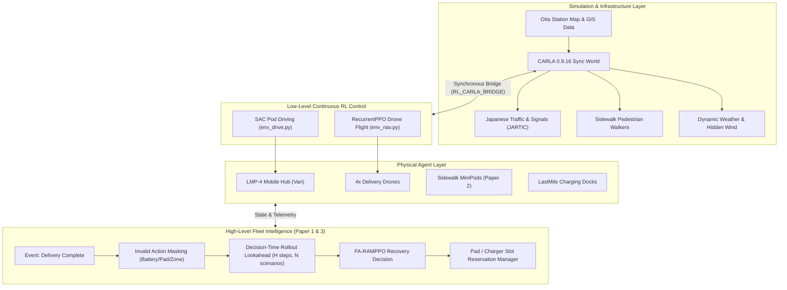
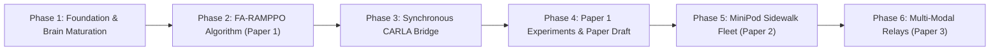

# Oita Last-Mile Autonomous Delivery Ecosystem: Master Research Synthesis & Phased Implementation Plan

> **Author**: Google Antigravity & IWN Lab  
> **Target Environment**: CARLA 0.9.16 (UE 4.26, Ubuntu 24.04, RTX 5080) & Standalone RL Pretender  
> **Target Scenario**: Real-world Oita Station Urban Map (`maps/build/OitaStation`)  
> **Core Documents**: `Oita_Last_Mile_Research_Plan_summery_V1.docx` & `Rollout_Assisted_Maskable_PPO_Oita_Paper1_Guide.docx`

---

## 1. Executive Summary & Core Understanding

### 1.1 What Is Happening in CARLA 0.9.16 (`PythonAPI/hil_sim`)
The current workspace hosts a **Human-in-the-Loop (HIL) driving simulator and multi-modal autonomous delivery rig** built on CARLA 0.9.16. Its existing components include:
1. **High-Fidelity Real-World Maps**: High-precision Japanese driving maps generated from OpenStreetMap and GIS data (notably **`OitaStation`** and `OitaKosen`), featuring authentic Japanese lane markings, traffic light timing (JARTIC type C/D), pedestrian sidewalk networks, 3D building colliders, and keep-left traffic rules.
2. **Delivery Assets & Vehicles**:
   - **LMP-4 Mobile Drone Hub**: An enclosed autonomous electric van equipped with a roof-mounted automated launch/recovery hatch, internal battery banks, weather monitoring mast, and parcel inventory.
   - **Delivery Drones**: Quadcopters capable of carrying small parcels, dropping them via tether/winch, and docking onto vehicle roof pads or fixed charging stations.
   - **MiniPods**: Autonomous wheeled sidewalk delivery robots designed for pedestrian zones and locker handoffs.
   - **LastMile Charging Docks**: Infrastructure featuring a 50 kW pod charging bay and multi-pad drone charging decks.
3. **The RL Delivery Engine (`rl_delivery/`)**:
   - Built under the philosophy of **"Pretend World First, CARLA for Validation"** to allow millions of training steps without 3D simulator rendering bottlenecks.
   - **Pod Driving Brain (`env_drive.py`)**: SAC continuous controller (steering, throttle/brake at 10 Hz) trained on road graphs, handling stop lines (止まれ), red lights, and kerb clearance.
   - **Drone Navigation Brain (`env_nav.py`)**: RecurrentPPO (LSTM, 20 Hz) controlling 3D flight in turbulent hidden wind fields, hovering at delivery points, and executing precision landings on the LMP-4 roof.
   - **Fleet Decision Brain (`env_fleet.py`)**: Turn-based multi-agent Maskable PPO coordinating pod movements, drone launch counts, locker deliveries, and charging trips.
4. **Current Architectural Gap**:
   - The trained RL brains currently run purely in the standalone "pretend world" and dashboard watch mode.
   - The live CARLA simulation (`delivery_sim.py`) still relies on scripted/heuristic logic (`BasicAgent`, rule dispatchers).
   - The bridge that feeds live CARLA state to the brains and sends control commands back to CARLA actors (`RL_CARLA_BRIDGE.md`) is designed but not yet implemented.

---

### 1.2 Synthesis of the Two Research Documents (IWN Lab Roadmap)

#### Document 1: `Oita_Last_Mile_Research_Plan_summery_V1.docx`
Establishes a cohesive **three-paper scientific trilogy** set in the Oita Station area, studying who carries a parcel from the depot to the customer:
- **Paper 1 (Drone Aerial Recovery)**: Customers are served exclusively by drones launched from an LMP-4 mobile hub. When a drone delivers its parcel, does it return to the moving LMP-4 at its next stop or divert to a fixed charging station? Focuses on handling road congestion delays, pad queues, and battery depletion.
- **Paper 2 (MiniPod Sidewalk Routing)**: Deliveries are performed by wheeled MiniPods navigating sidewalks and pedestrian zones. Focuses on pedestrian-aware navigation, traffic-light crossings, and dynamic parcel re-assignment (a peer MiniPod collecting a delayed robot’s parcel).
- **Paper 3 (Heterogeneous Coordinated Relays)**: Unifies drones and MiniPods. Drones handle long-distance aerial legs, while MiniPods handle dense pedestrian legs, supporting two-stage handoffs (drone-to-MiniPod relay) or parallel fulfillment.

#### Document 2: `Rollout_Assisted_Maskable_PPO_Oita_Paper1_Guide.docx`
Defines the concrete algorithmic innovation for Paper 1: **Fleet-Aware Rollout-Assisted Maskable PPO (FA-RAMPPO)**.
- **The Core Problem**: Standard PPO reactive policies pick actions based only on the current state. When a drone finishes delivery, returning to the mobile hub might seem optimal; but if traffic delays the hub or multiple drones crowd the roof pad simultaneously, expensive air-hovering drains batteries, stranding drones or delaying parcel readiness.
- **The FA-RAMPPO Architecture**:
  1. **Event-Triggered Decision**: Drone $D_i$ finishes parcel handoff.
  2. **Action Generation**: Discrete candidates: Return to Hub Stop $S_k$, Divert to Fixed Charger $C_j$, or Safe Hold.
  3. **Invalid Action Masking**: Dynamically mask out physically impossible options (insufficient battery margin with safe reserve, occupied pad, closed airspace, unstopped hub).
  4. **Decision-Time Lookahead (Counterfactual Rollout)**: For each remaining feasible action $k \in K$, simulate short future trajectories ($H \approx 3\text{--}6$ decision events) across $N$ disturbance scenarios (traffic delay, wind gusts, charger queues) using a fast execution model.
  5. **Fleet-Level Selection**: Choose the candidate with the highest expected fleet return (minimizing time-to-next-parcel-readiness and energy waste).
  6. **CARLA Validation**: Execute the chosen policy inside synchronous CARLA on the Oita Station map.

---

### 1.3 The Ultimate End Goal

The end goal is an **autonomous, end-to-end, multi-modal urban delivery system** operating inside a photorealistic digital twin of Oita Station, underpinned by a published scientific trilogy:
1. **Fully Autonomous Physical Fleet**: Mobile LMP-4 hubs, multi-rotor drones, and sidewalk MiniPods that drive, fly, avoid obstacles, obey Japanese traffic rules, and land safely in realistic weather.
2. **Intelligent Fleet Brain**: An RL coordination engine (FA-RAMPPO) that guarantees **zero stranded vehicles**, eliminates pad queuing deadlocks, and dynamically synchronizes aerial and ground vehicles under real-world traffic congestion.
3. **Rigorous Academic Publication**: High-impact experimental evidence, ablation studies, and open benchmarks demonstrating the superiority of rollout-assisted decision-making over standard PPO and heuristic baselines.

---

## 2. Phased Implementation Master Plan

The complete roadmap is structured into **6 sequential, milestone-driven phases**.

---

### Phase 1: Foundation & Low-Level Brain Maturation (Pretend World)
*Goal: Ensure baseline low-level continuous control brains (`nav` and `drive`) reach CARLA-ready readiness gates in the fast simulation.*

#### Tasks:
1. **Drone Navigation (`env_nav.py`)**:
   - Continue RecurrentPPO training through curriculum to 1,000 m ranges with turbulent wind.
   - **Readiness Gate**: Landing on moving/parked pod roof in $\ge 70\%$ of two-leg flights with hidden wind on test seeds.
2. **Pod Driving (`env_drive.py`)**:
   - Fine-tune SAC driving to eliminate startup hesitations and speed up to realistic city velocities ($20\text{--}35\text{ km/h}$).
   - **Readiness Gate**: Reaching $\ge 75\%$ of 400 m+ routes in dense traffic with 0 stop line violations and $\approx 0$ kerb strikes.
3. **Map Extraction for Oita Station**:
   - Generate `maps/OitaStation.json`, `maps/OitaStation_heights.npz`, and `maps/OitaStation_drive.json` matching the imported extended Oita Station map.

---

### Phase 2: Fleet-Aware Rollout-Assisted Maskable PPO (Paper 1 Core Method)
*Goal: Implement the complete FA-RAMPPO algorithm and counterfactual rollout lookahead module.*

#### Tasks:
1. **Reservation & Slot Manager (`fleet_rules.py`)**:
   - Build explicit reservation calendars for the LMP-4 roof pad and fixed charger ports.
   - Enforce single-pad occupancy and slot expiration timeouts if the hub is delayed by traffic.
2. **Action Masking Engine (`action_mask.py`)**:
   - Compute dynamic boolean masks for recovery actions:
     - Check battery energy against distance + wind + required reserve ($E_{res} \ge 15\%$).
     - Check arrival time window against LMP-4 planned stop duration.
     - Check airspace restriction and charger availability.
3. **Decision-Time Rollout Evaluator (`rollout_evaluator.py`)**:
   - Implement the fast forward simulator that runs at decision time:
     - Evaluates $K$ feasible candidate recovery actions.
     - Projects fleet state over horizon $H \in \{3, 4, 5\}$ future decision events.
     - Samples $N \in \{3, 5\}$ disturbance scenarios (traffic delay to hub, wind variation, charger queue delays).
     - Returns expected fleet score: $J(a) = \mathbb{E}[\text{Readiness Time}] + \alpha \cdot \text{Energy Margin} - \beta \cdot \text{Deadline Risk}$.
4. **Offline Benchmarking in Pretend World**:
   - Benchmark FA-RAMPPO against Standard PPO, Maskable PPO, and Rule-Based Greedy recovery.

---

### Phase 3: The Synchronous CARLA Bridge
*Goal: Connect the trained RL brains to live 3D actors in CARLA 0.9.16.*

#### Tasks:
1. **Bridge Architecture (`delivery/rl_bridge.py`)**:
   - Implement strict **Observation Parity**:
     - Extract drone state from CARLA actors into the exact 54-number vector required by `env_nav.py`.
     - Extract pod state and route lookahead from CARLA into the exact 30-number vector required by `env_drive.py`.
     - Extract fleet telemetry into the FA-RAMPPO decision state.
2. **Synchronous Execution Loop**:
   - Tie CARLA's fixed time-step (`delta_seconds = 0.05`, 20 Hz) to the agent control loops:
     - Drone Nav: Stepped every tick (20 Hz).
     - Pod Driving: Stepped every 2 ticks (10 Hz).
     - Fleet Decisions: Stepped on discrete events (order delivery, docking, low battery).
3. **Actuation & Physics Mapping**:
   - Map continuous drone actions to kinematic transform updates via `drone_dyn.py` and hidden wind.
   - Map SAC pod actions to `carla.VehicleControl(throttle, steer, brake)`.
4. **Dashboard Integration**:
   - Add checkpoint picker and live RL telemetry toggles to the React dashboard AI training page.

---

### Phase 4: Paper 1 Experimental Campaign & Publication Package
*Goal: Execute matched evaluation scenarios, compile statistical evidence, and draft Paper 1.*

#### Tasks:
1. **Oita Station Evaluation Scenarios**:
   - 3 distinct traffic levels: Light (free flow), Moderate (peak morning), Heavy (congested station square).
   - 3 weather regimes: Calm, Gusty Wind ($8\text{--}12\text{ m/s}$), Light Rain.
   - Order sets: 20, 40, and 60 orders distributed across Oita Station commercial and residential buildings.
2. **Matched Comparative Experiments**:
   - Run 30 seeds per configuration across 4 policies:
     1. Heuristic Rule-Based Baseline (nearest available resource).
     2. Standard PPO (unmasked).
     3. Maskable PPO (masked, reactive policy only).
     4. **FA-RAMPPO** (our proposed rollout-assisted method).
3. **KPI Collection & Analysis**:
   - On-time delivery rate ($\% \le \text{deadline}$).
   - Fleet readiness turnaround time (minutes until all 4 drones are recharged and re-armed).
   - Energy consumption (Wh/km and total kWh).
   - Pad queuing delay and hovering waste.
   - Failure metrics: battery strandings, pad collisions, timeout drops.
4. **Paper 1 Manuscript Preparation**:
   - Complete draft following the outline in `Oita_Last_Mile_Research_Plan_summery_V1.docx`.

---

### Phase 5: Autonomous MiniPod Sidewalk Fleet (Paper 2)
*Goal: Implement pedestrian-aware wheeled MiniPod delivery in pedestrian zones and sidewalks.*

#### Tasks:
1. **Sidewalk Graph & Crossing Network**:
   - Compile detailed pedestrian sidewalk network and zebra crossings from Oita Station xodr.
2. **MiniPod Control & Routing (`env_minipod.py`)**:
   - Continuous collision-avoidance policy for dynamic pedestrian crowds (`carla.Walker`).
   - Signal-aware zebra crossing traversal.
3. **Dynamic Parcel Re-Assignment**:
   - Multi-robot task allocator that transfers a pending parcel to a peer MiniPod when a robot is obstructed or delayed.
4. **Paper 2 Experiments**:
   - Benchmark delivery completion and pedestrian clearance against classical A*/Dijkstra and static routing.

---

### Phase 6: Coordinated Multi-Modal Relays (Paper 3 & Full Rig Demo)
*Goal: Integrate Drones and MiniPods into a unified cooperative last-mile delivery ecosystem.*

#### Tasks:
1. **Multi-Modal Coordination Brain (`env_multimodal.py`)**:
   - Dynamic mode selection: Drone direct vs MiniPod direct vs Two-stage Relay (Drone flies parcel to a suburban handover pad; MiniPod performs final doorstep delivery).
2. **Physical Relay Handoff in CARLA**:
   - Precision winch drop from drone onto the MiniPod cargo bay at designated rendezvous points.
3. **End-to-End Live Demonstrator**:
   - Complete live delivery showcase on the Oita Station map with Logitech G923 driver vehicle interacting alongside the autonomous LMP-4 hub, flying drones, and sidewalk MiniPods.
4. **Paper 3 Publication Package**:
   - Multi-modal trade-off curves: delivery latency vs energy consumption across urban density profiles.

---

## 3. Immediate Action Items (Next Sprint)

1. **Verify low-level pretender benchmarks**: Confirm `nav` reaches $\ge 70\%$ landing success at 650m and `drive` reaches stable road cruising.
2. **Create `rl_delivery/ramp_ppo.py`**: Scaffold the FA-RAMPPO action mask and rollout lookahead evaluator.
3. **Implement the CARLA Bridge Prototype**: Create `hil_sim/delivery/rl_bridge.py` and test passing kinematic observations from CARLA into `nav` and `drive` checkpoints.
4. **Update Handoff & Experiment Logs**: Record all architectural decisions in `PythonAPI/hil_sim/rl_delivery/HANDOFF.md`.
