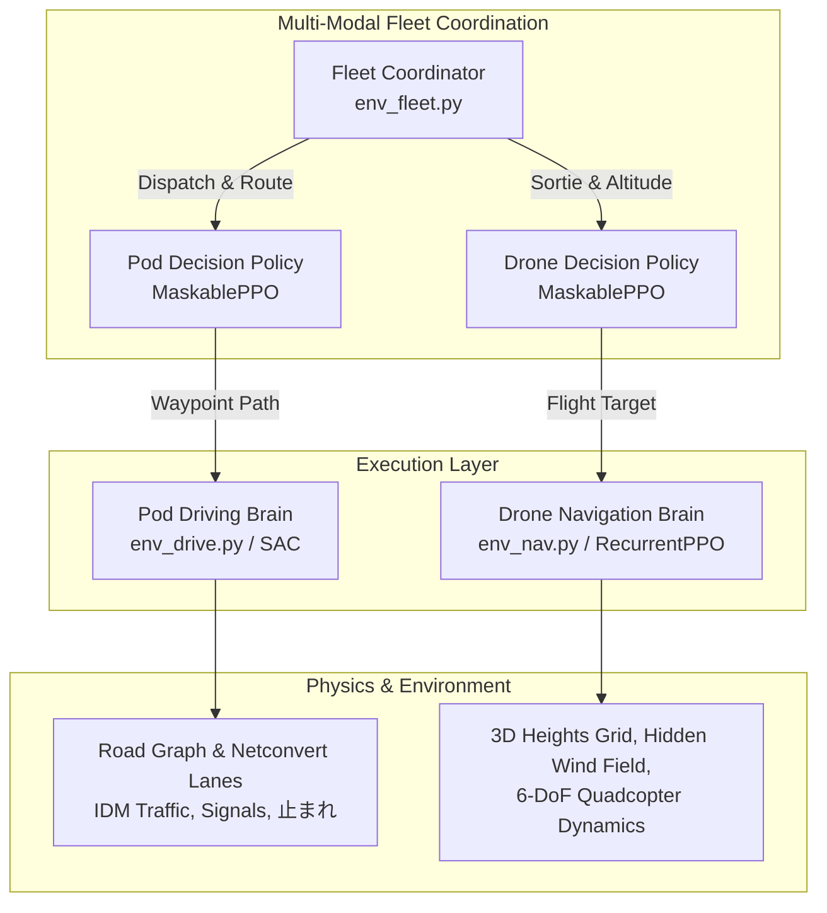

# Autonomous Last-Mile Multi-Modal RL Delivery System Specification
## Complete Theoretical, Architectural, and Implementation Reference

> **Target Audience:** Autonomous Agents, RL Researchers, and System Engineers.  
> **Location:** `PythonAPI/hil_sim/docs/RL_DELIVERY_SPECIFICATION.md`  
> **Source Repository:** `PythonAPI/hil_sim/rl_delivery/`  
> **Target Environment:** CARLA 0.9.16 (UE 4.26), OitaKosen & OitaStation City Maps.

---

## 1. System Overview & The Pure-RL Philosophy

This reinforcement learning framework trains an autonomous, coordinated, multi-modal last-mile logistics fleet operating across complex Japanese urban road topologies. The fleet consists of:
1. **LMP-4 Mobile Pods:** Electric robotic delivery vehicles carrying parcels, robotic swap arms, and charging infrastructure.
2. **Autonomous Quadcopter Drones:** Aerial delivery units docked on the pod roofs, capable of taking off, navigating 3D urban terrain, delivering parcels, and dynamically landing back on the moving pod.
3. **Smart Lockers & Charging Yard Infrastructure:** Stationary drop nodes and 50 kW fast-charging stations.



### The Non-Negotiable Core Principles
* **Pure RL — Zero Hardcoded Driving/Steering:** No rule-based overrides, no artificial geofencing, no emergency stop vetoes, no hardcoded steering filters. Every control action is produced directly by trained neural network policies.
* **Pretend-World-First:** Policies are trained in hyper-fast, parallelized, physics-grounded Python simulations before transfer into the CARLA 0.9.16 simulator.
* **Honest World Physics:** Drones face aerodynamic drag, motor reaction lag, rotor saturation, and realistic hidden wind turbulence. Pods experience vehicle inertia, tyre slip limits, road curvature, and traffic signals.
* **Adversarial Reality & Failures Allowed:** Battery drains realistically, drones crash if they strike eaves or trees, and pods become stranded if battery reaches zero. The agent must discover safety constraints entirely through environmental rewards and action masks.

---

## 2. Global Architecture & The 3 Core Brains

The system is factored into three specialized, interacting reinforcement learning layers:

| Brain Layer | Environment File | Algorithm | Action Type | Control Frequency | Primary Objective |
|---|---|---|---|---|---|
| **Fleet Coordinator** | [`env_fleet.py`](file:///home/inouelab/Downloads/CARLA_0.9.16/PythonAPI/hil_sim/rl_delivery/env_fleet.py) | **MaskablePPO** | Discrete (28 Pod, 4 Drone) | Decision-driven (~30s) | Macro-level dispatch: order assignment, drone sortie timing, rendezvous location, charging logistics. |
| **Pod Driving** | [`env_drive.py`](file:///home/inouelab/Downloads/CARLA_0.9.16/PythonAPI/hil_sim/rl_delivery/env_drive.py) | **SAC** | Continuous `Box(2)` | 10 Hz ($\Delta t = 0.1\text{ s}$) | Micro-level vehicle control: steering, throttle, braking along OpenDrive lanes without touching kerbs or violating traffic laws. |
| **Drone Navigation** | [`env_nav.py`](file:///home/inouelab/Downloads/CARLA_0.9.16/PythonAPI/hil_sim/rl_delivery/env_nav.py) | **RecurrentPPO** | Continuous `Box(4)` | 20 Hz ($\Delta t = 0.05\text{ s}$) | 3D flight trajectory: obstacle avoidance around buildings/canopies and dynamic landing onto moving pod roof in hidden wind. |

---

## 3. Brain 1: Fleet Coordinator (`env_fleet.py`)

### 3.1 Macro Dynamics & Energy Mechanics
* **Simulation Step:** $\Delta t = 5.0\text{ s}$, Episode Duration: $3\text{ hours}$ simulated ($10,800\text{ s}$).
* **Fleet Configuration:** 3 LMP-4 Mobile Pods, each carrying up to 4 drones (12 drones total across the fleet), operating across spatial pod zones extracted from OpenStreetMap.
* **The Drone Energy Siphon:** Drones docked inside a pod recharge directly from the pod's 10 kWh battery:
  $$\Delta E_{\text{pod}} = \Delta E_{\text{drone}} \times \frac{\text{drone\_Wh}}{\text{pod\_kWh} \times 1000 \times \eta_{\text{charger}}}$$
  Where $\eta_{\text{charger}} = 0.90$ (90% charger efficiency). Thus, frequent drone sorties heavily drain the host vehicle's battery.
* **Pod Power Drain:**
  - Driving: $P_{\text{drain\_km}} \times \text{distance}$
  - Idling: $P_{\text{idle}} \times \Delta t$
  - Drone recharging: Siphoned power per docked drone.
* **Charging Infrastructure:** 50 kW fast chargers. When plugged in:
  $$\text{rate} = \frac{50\text{ kW}}{10\text{ kWh}} \times \frac{100\%}{3600} \times \Delta t \approx 0.694\%/\text{s}$$
  A full 10% to 90% charge takes $\approx 115\text{ s}$ of simulator time.

### 3.2 Alternating Two-Brain Policy Optimization
`env_fleet.py` houses two policies trained in turns:
1. `fleet_pod`: Master vehicle dispatch policy.
2. `fleet_drone`: Drone sortie and release policy.

During training, round-steps are partitioned (typically 200,000 steps per round). In Round $2k$, `fleet_pod` learns while `fleet_drone` is frozen; in Round $2k+1$, `fleet_drone` learns while `fleet_pod` is frozen.

### 3.3 Observation Spaces
* **Pod Observation (96 dimensions):**
  - Pod internal state: battery level, currently charging flag, active drone order queue, active face-to-face order queue.
  - Candidate dispatch spots: $(x, y)$ coordinates and order counts.
  - Candidate meeting points: relative distance and estimated travel time.
  - Locker states: availability, pending parcels.
  - Charging station status: bay occupancy, queue lengths, distance.
  - Open sky index: canopy overhead density (affects takeoff crash probability).
* **Drone Observation (16 dimensions):**
  - Battery percentage, payload status, relative distance to assigned delivery building.
  - Parent pod relative position and velocity vector.
  - Weather condition: current rain intensity and ground turbulence.

### 3.4 Action Space Layout ($N_{pod} = 28$)
```
[0 .. 5]   : A_SPOT   (Drive to dispatch hotspot candidate 0..5)
[6 .. 17]  : A_LAUNCH (Launch n=1..4 drones to meeting candidate 0..2)
[18 .. 21] : A_LOCK   (Drive to smart locker 0..3 for dropoff)
[22]       : A_GOMEET (Drive to rendezvous point to recover returning drones)
[23 .. 25] : A_CHARGE (Drive to 50 kW charging station 0..2)
[26]       : A_SWAP   (Call a battery swap from standby pool for lowest drone)
[27]       : A_WAIT   (Hold position / dwell)
```

### 3.5 Hierarchical Action Masking (Anti-Stranding & Anti-Farming Protocol)
MaskablePPO enforces valid action subsets via boolean masking:
1. **High-Battery Charge Lock ($\text{Battery} \ge 50\%$):**
   - Masks out `A_CHARGE` (indices 23..25). Prevents policy from repeatedly docking at nearby chargers to farm arrival bonuses when battery is already abundant.
2. **Low-Battery Dispatch Lock ($\text{Battery} < 25\%$):**
   - Forbids new drone launches (`A_LAUNCH`) and dispatching to delivery spots (`A_SPOT`).
3. **Emergency Charging Constraint ($\text{Battery} < 15\%$):**
   - Forbids all locker runs (`A_LOCK`), battery swaps (`A_SWAP`), and unprompted waiting (`A_WAIT`).
   - Forces the action selection strictly to `A_CHARGE` (or `A_GOMEET` if active drones are airborne and need immediate recovery).

### 3.6 Fleet Reward Formulation
$$\mathcal{R}_{\text{fleet}} = \mathcal{R}_{\text{deliveries}} + \mathcal{R}_{\text{docking}} - \mathcal{P}_{\text{swap}} - \mathcal{P}_{\text{batt}} - \mathcal{P}_{\text{stranded}} - \mathcal{P}_{\text{crash}} - \mathcal{P}_{\text{dwell}} - \mathcal{P}_{\text{starvation}}$$

* **Parcel Delivery:** $+40.0$ (drone drop), $+60.0$ (direct face-to-face locker drop).
* **Energy-Conditioned Charging Reward:** Rather than an unconditional flat arrival bonus, reward is tied to actual replenishment:
  $$\mathcal{R}_{\text{docking}} = +40.0 \times \min\left(\frac{\Delta \text{SoC}}{40\%}, 1.0\right) \quad (\text{only paid if entering with batt} < 35\%)$$
* **Battery Swap Overhead Penalty:** $-10.0$ per `A_SWAP` execution, plus a finite standby pool (max 4 swaps/episode), eliminating the "free-energy" exploit.
* **Low-Battery Warning Penalty:**
  $$\mathcal{P}_{\text{batt}} = 0.1 \times \left(\frac{25.0 - \text{batt}}{5.0}\right)^2 \times \frac{\Delta t}{5.0} \quad (\text{for batt} < 25\%)$$
* **Order Starvation / SLA Escalation Penalty:**
  $$\mathcal{P}_{\text{starvation}} = 0.05 \times \sum_{o \in \text{unfulfilled}} \max\left(0, \frac{\text{age}(o) - 1800\text{ s}}{600\text{ s}}\right)^2$$
  Severely penalizes cherry-picking strategies that abandon distant or hard-to-reach orders.
* **Catastrophic Stranding Penalty:** $-2500.0$ if pod hits $0.0\%$ battery.
* **Drone Crash Penalty:** $-150.0$ per drone crash (obstacle, canopy, or dead battery).
* **Unproductive Wait Penalty:** $-3.0$ per step if waiting while deliverable orders or low battery exist.

---

## 4. Brain 2: Pod Driving Brain (`env_drive.py`)

### 4.1 Vehicle Kinematics & Physics Model
* **Control Rate:** 10 Hz ($\Delta t = 0.1\text{ s}$).
* **Vehicle Dimensions:** Kinematic bicycle model matching LMP-4:
  - Wheelbase: $L = 2.6\text{ m}$, Half-width: $W/2 = 0.8\text{ m}$, Overall Length: $3.6\text{ m}$.
  - Steering Limits: $\delta_{\text{max}} = 0.6\text{ rad} \approx 34.4^\circ$, Steering Slew Rate: $1.2\text{ rad/s}$.
  - Acceleration / Braking: Symmetric limits $a_{\text{max}} = 3.0\text{ m/s}^2, a_{\text{brake}} = -3.0\text{ m/s}^2$.
  - Target Max Speed: $v_{\text{max}} = 30\text{ km/h} \approx 8.33\text{ m/s}$.
* **Equations of Motion:**
  $$\dot{x} = v \cos(\psi), \quad \dot{y} = v \sin(\psi), \quad \dot{\psi} = \frac{v}{L} \tan(\delta)$$
  $$v_{t+1} = \text{clip}(v_t + a \Delta t, 0, v_{\text{max}})$$
* **Traffic Simulation:** Surrounding NPC vehicles follow the Intelligent Driver Model (IDM) along the route, stopping lawfully at red lights and stop lines.

### 4.2 Observation State Vector (30 Continuous Features)
All features are normalized within $[-10.0, 10.0]$:

| Index | Feature | Normalization / Units | Description |
|---|---|---|---|
| `0` | $v / v_{\text{max}}$ | $[0, 1]$ | Current forward velocity. |
| `1` | $\delta / \delta_{\text{max}}$ | $[-1, 1]$ | Current front wheel steering angle. |
| `2` | $\text{off} / 2.0$ | Meters / 2 | Lateral offset from lane center line. |
| `3` | $\Delta \psi$ | Radians | Heading error relative to lane tangent. |
| `4` | $W_{\text{lane}} / 4.0$ | Meters / 4 | Width of current driving lane. |
| `5..7` | $\mathbf{e}_{\text{left}}$ | One-hot 3D | Left edge type: `[kerb, lane_mark, oncoming]`. |
| `8..10` | $\mathbf{e}_{\text{right}}$ | One-hot 3D | Right edge type: `[kerb, lane_mark, oncoming]`. |
| `11` | $\text{is\_junction}$ | Binary $\{0, 1\}$ | Whether pod is inside an intersection. |
| `12..16` | $\kappa_{5}, \kappa_{10}, \kappa_{20}, \kappa_{30}, \kappa_{40}$ | Radians | Curvature preview at 5, 10, 20, 30, and 40 m ahead. |
| `17` | $d_{\text{mark}} / 60.0$ | $[0, 1]$ | Distance to upcoming stop line or signal. |
| `18..19` | $\mathbf{t}_{\text{mark}}$ | One-hot 2D | Mark type: `[is_stop_sign, is_traffic_signal]`. |
| `20..22` | $\mathbf{c}_{\text{sig}}$ | One-hot 3D | Signal light phase: `[red, yellow, green]`. |
| `23` | $\text{stopped\_ok}$ | Binary $\{0, 1\}$ | True if pod came to full stop ($<0.3\text{ m/s}$) within 4 m of line. |
| `24` | $d_{\text{lead}} / 60.0$ | $[0, 1]$ | Distance gap to lead vehicle. |
| `25` | $(v - v_{\text{lead}}) / 10.0$ | $[-1, 1]$ | Relative closing speed. |
| `26` | $v_{\text{limit}} / 60.0$ | $[0, 1]$ | Legal lane speed limit. |
| `27` | $d_{\text{rem}} / 800.0$ | $[0, 1]$ | Remaining distance to end of route. |
| `28..29` | $\mathbf{a}_{t-1}$ | $[-1, 1]^2$ | Previous action applied: `[steer, pedal]`. |

### 4.3 Action Space
Continuous action vector $\mathbf{a} \in [-1.0, 1.0]^2$:
* $a_0$: Steering demand $\to \delta_{\text{target}} = a_0 \times \delta_{\text{max}}$.
* $a_1$: Longitudinal pedal $\to$ Acceleration if $a_1 > 0$, Braking if $a_1 \le 0$.

### 4.4 The Standstill Local Minimum & Anti-Hacking Reward Structure
$$\mathcal{R}_{\text{drive}} = r_{\text{prog}} + r_{\text{vel}} - r_{\text{lat}} - r_{\text{jerk}} - r_{\text{step}} - \mathcal{P}_{\text{standstill}} - \mathcal{P}_{\text{violations}}$$

* **Progress Reward (High-Water Mark):** $+0.3 \times (s - s_{\text{best}})$ (strictly monotonic forward progress along lane centerline).
* **Tangential Velocity Incentive:**
  $$r_{\text{vel}} = +0.05 \times \min\left(\frac{v \cos(\Delta\psi)}{\min(v_{\text{limit}}, v_{\text{max}})}, 1.0\right) \quad (\text{when road is clear})$$
  Multiplied by $\cos(\Delta\psi)$ so lateral weaving or fishtailing does not harvest velocity points.
* **Per-Step Time Penalty:** $r_{\text{step}} = 0.06$ per step ($0.6/\text{s}$). Because $r_{\text{step}} > \max r_{\text{vel}}$, crawling at micro-speeds ($0.35\text{ m/s}$) incurs a net negative return.
* **Stop-Sign Stall Timeout & Unprompted Standstill:**
  - If $v < 0.3\text{ m/s}$ with no obstacle or valid red light: $-0.25/\text{step}$.
  - At a 止まれ (stop sign): once the vehicle stops ($v < 0.3\text{ m/s}$ within $4.0\text{ m}$) and $\text{stopped\_ok}$ becomes True, the stop obligation is satisfied. If the pod remains stationary for $> 5.0\text{ s}$ when lead traffic is clear, the stall abort triggers ($-35.0$ penalty, `end = stalled`). Camping inside the stop zone is impossible.
  - If stationary $> 4.0\text{ m}$ before the line (e.g., at $8\text{ m}$), the stall timer continues running because the vehicle has not reached the legal stopping window.
* **Terminal Red-Light Infraction:** Running a red light incurs $-40.0$ and **terminates the episode immediately** (`end = red_violation`). This prevents the replay buffer from normalizing blowing through intersections to collect goal bonuses.
* **止まれ (Stop Sign) Violation:** Crossing without stopping within $4.0\text{ m}$ incurs $-25.0$.
* **Kerb Collision Penalty:** $-40.0$ and immediate termination if tire envelope crosses kerb by $> 0.25\text{ m}$.
* **Vehicle Collision:** Striking lead car incurs $-50.0$ and immediate termination.
* **Goal Completion:** $+30.0$ bonus when arriving within $3.0\text{ m}$ of route endpoint.

### 4.5 Robust Curriculum Progression
Curriculum advances only when all three safety gates pass simultaneously:
1. $\text{reached} \ge 75\%$
2. $\text{kerb\_rate} + \text{collision\_rate} + \text{stalled\_rate} \le 10\%$
3. $\text{infractions\_per\_km} < 0.10$

This prevents "early-crash gaming" where dying in 25% of episodes artificially suppressed infraction counts.

---

## 5. Brain 3: Drone Navigation Brain (`env_nav.py`)

### 5.1 Quadcopter Dynamics & Hidden Wind
* **Control Rate:** 20 Hz ($\Delta t = 0.05\text{ s}$).
* **Actuation Dynamics with Lag:** Rigid body with aerodynamic drag and motor response lag:
  $$\tau_{\text{att}} \dot{\boldsymbol{\theta}} = \boldsymbol{\theta}_{\text{cmd}} - \boldsymbol{\theta}, \quad \tau_{\text{att}} = 0.15\text{ s}$$
  $$\tau_{\text{thr}} \dot{T} = T_{\text{cmd}} - T, \quad \tau_{\text{thr}} = 0.10\text{ s}$$
* **Hidden Wind Physics:** The wind vector $\mathbf{w}(x,y,z,t)$ is **never given in the observation**. It consists of:
  - Base wind with Weibull speed distribution.
  - Directional discrete gusts with exponential ramps.
  - Building wake turbulence computed via `BuildingGrid` (2m resolution cells).
  - RecurrentPPO uses its LSTM cell state to implicitly deduce the latent wind vector from IMU acceleration deviations.

### 5.2 Sensor Observations
1. **IMU / Odometry:** Velocity vector $\mathbf{v}$, body acceleration $\mathbf{a}$, roll, pitch, yaw rate, battery percentage.
2. **Mission Targets:** Relative vector to target parcel drop $(x_d, y_d, z_d)$ or return pod roof pad.
3. **Altitude Rangefinders:** Downward clearance to ground surface, height above obstacles directly below.
4. **LiDAR Rings:**
   - 16 horizontal rays at current flight altitude out to $40\text{ m}$.
   - 8 downward-tilted rays ($5\text{ m}$ lower) detecting rooftops/poles beneath the descent corridor.
5. **No-Fly Proximity:** Distances to nearest no-fly boundary along 8 compass bearings.

### 5.3 Action Space
Continuous action $\mathbf{u} \in [-1.0, 1.0]^4$:
* $u_0$: Roll angle command ($\pm 30^\circ$).
* $u_1$: Pitch angle command ($\pm 30^\circ$).
* $u_2$: Normalized collective thrust ($0 \to 2.0 \times \text{hover}$).
* $u_3$: Yaw rate command ($\pm 90^\circ/\text{s}$).

### 5.4 Mission Sequence & Anti-Hacking Rewards
A sortie consists of two consecutive phases:
1. **Outbound Leg:** Fly from pod roof to drop site, descend and hover within $4\text{ m} \le z \le 10\text{ m}$ at speed $< 1.0\text{ m/s}$ (parcel release).
2. **Inbound Recovery Leg:** Locate moving pod roof, descend, match velocity, and touch down on the $2.6\text{ m}$ pad.

* **High-Water-Mark Progress Reward:**
  $$r_{\text{prog}} = +0.3 \times \max(0, d_{\text{best}} - d_t), \quad d_{\text{best}} \leftarrow \min(d_{\text{best}}, d_t)$$
  $d_{\text{best}}$ resets only once upon transitioning from Outbound to Inbound leg. This eliminates infinite distance oscillation loops under discounting.
* **Terminal Drop Reward:** $+100.0$ on valid drop delivery.
* **Precision Landing Reward:** $+150.0$ upon satisfying all physical touchdown constraints:
  - Pad radius clearance: $\Vert{}(x, y)_{\text{drone}} - (x, y)_{\text{pod}}\Vert{} < 1.3\text{ m}$.
  - Vertical descent speed: $-1.5\text{ m/s} < v_z \le 0.0\text{ m/s}$.
  - Relative horizontal velocity: $\Vert{}\mathbf{v}_{xy,\text{drone}} - \mathbf{v}_{xy,\text{pod}}\Vert{} < 1.2\text{ m/s}$.
  - **Attitude Tilt Constraint:** $\vert{}\text{roll}\vert{} \le 12^\circ$ and $\vert{}\text{pitch}\vert{} \le 12^\circ$.
  - Breaching velocity or attitude limits on contact registers as `crash_pod` ($-100.0$ penalty).
* **Airborne Timeout Penalty:** If $t \ge \text{MAX\_S}$ (480s) and the drone is airborne, $-100.0$ terminal penalty is applied (`crash = timeout`), completely eliminating the "hover out the clock" exploit.
* **Obstacle Strike Crash:** $-100.0$ and termination if hitting any building, eaves, or tree canopy.
* **No-Fly Violation:** $-100.0$ if entering restricted airspace.
* **Ceiling Breach:** $-50.0$ if exceeding $150\text{ m}$ AGL (Japanese Aviation Law limit).
* **Battery Depletion:** $-100.0$ if battery hits $0.0\%$.

---

## 6. KPI Settings, Metrics & Baselines

### 6.1 Progress CSV Formats

#### Fleet (`results/fleet_progress.csv`)
```csv
round,policy,timesteps,wall_s,deliveries_per_h,crashes_per_100,lead_mean_s,max_order_age_s,unfulfilled_expired_rate,stranded,hover_s_per_h,deliv_30,wait_30,strand_30,deliv_72,wait_72,strand_72
```
* `max_order_age_s`: Longest wait time of any pending order (prevents starvation of hard orders).
* `unfulfilled_expired_rate`: Percentage of orders exceeding SLA threshold ($1800\text{ s}$).

#### Pod Driving (`results/drive_progress.csv`)
```csv
steps,wall_s,route_len,traffic,reached,kerb,collision,stop_violations,red_violations,centre_s,speeding_s,speed,p10_speed,ep_reward
```
* `p10_speed`: 10th percentile forward velocity when clear (exposes sprint-then-crawl policies).

#### Drone Navigation (`results/nav_progress.csv`)
```csv
steps,wall_s,wind_level,dist,landed_on_pod,delivered,crash_pod,crash_total,crash_obstacle,crash_nofly,crash_ceiling,crash_battery,timeout,min_clear,battery_used,time_s,ep_reward
```
* `timeout`: Must remain $0.0\%$ to confirm no agents are abandoning return legs.

### 6.2 Target Benchmarks & Baselines

| Brain | Metric | Scripted / Rule Baseline | RL Minimum Passing Target | Production State Target |
|---|---|---|---|---|
| **Fleet** | Deliveries / hour | 12.0 | $\ge 18.0$ | $\ge 25.0$ |
| | Stranded Pods | 0.0 | $\le 0.5$ | **0.0** |
| | Crashes / 100 | 18.0 | $\le 12.0$ | $\le 8.0$ |
| | Max Order Age | $1200\text{ s}$ | $\le 1800\text{ s}$ | $\le 900\text{ s}$ |
| **Drive** | Goal Reached Rate | 65% | $\ge 75\%$ | $\ge 90\%$ |
| | Average Speed | 2.5 m/s | $\ge 2.5\text{ m/s}$ | $\ge 3.5\text{ m/s}$ |
| | P10 Speed (clear) | 1.8 m/s | $\ge 2.0\text{ m/s}$ | $\ge 2.8\text{ m/s}$ |
| | Kerb Strikes | 10% | $\le 10\%$ | $\le 2\%$ |
| | Stop / Red Violations | 0.0 | $< 0.1$ | **0.0** |
| **Nav** | Delivery Rate | 50% | $\ge 70\%$ | $\ge 85\%$ |
| | Mobile Pad Landing | 30% | $\ge 60\%$ | $\ge 80\%$ |
| | Return Timeout Rate | 0% | **0.0%** | **0.0%** |
| | Battery Exhaustion | 5% | **0.0%** | **0.0%** |

---

## 7. Operational Guidelines for Future AI Agents

1. **Checkpoint Filename vs. Modification Time:**
   Always use file modification time (`os.path.getmtime`) rather than parsing integer filenames (`int(basename[5:-4])`).
2. **Background Process Management:**
   Training jobs should always be spawned with unbuffered output (`PYTHONUNBUFFERED=1`) and proper environment paths (`PYTHONPATH=.`). Never kill processes using shell string patterns that match the current terminal.
3. **Hyperparameter Invariants:**
   - In `DriveEnv`, never remove the stall early abort ($v < 0.3\text{ m/s}$ for $> 5\text{ s}$). Without it, SAC policies will reliably collapse into standstill brake locks.
   - In `FleetEnv`, never disable low-battery action masking ($< 15\%$ battery). Without it, the policy will sacrifice pods to maximize immediate delivery points.
4. **Transition to CARLA Bridge:**
   When bridging to CARLA 0.9.16 (`PythonAPI/hil_sim/docs/RL_CARLA_BRIDGE.md`), map the continuous actions directly to `carla.VehicleControl`:
   ```python
   steer = float(np.clip(action[0], -1.0, 1.0))
   throttle = float(max(action[1], 0.0))
   brake = float(max(-action[1], 0.0))
   ```
   Do not introduce hand-tuned steering PID layers; trust the SAC policy's learned lateral dynamics.

---

## 8. Anti-Exploitation Protocols & Reward-Hacking Proofing Matrix

| Environment | Vulnerability Vector | Mathematical Exploit | Proofed Protection Mechanism |
|---|---|---|---|
| **`env_fleet.py`** | Charger Docking Loop | Leaving and re-entering bay to farm $+40.0$ docking reward with high battery. | Mask `A_CHARGE` when $\text{batt} \ge 50\%$; reward scaled strictly by energy replenished $\min(\Delta\text{SoC}/40\%, 1.0)$. |
| **`env_fleet.py`** | `A_SWAP` Free Energy | Spamming drone battery swaps to avoid pod battery siphon at 0 cost. | $-10.0$ logistics penalty per swap; maximum 4 standby swaps per episode quota. |
| **`env_fleet.py`** | Starvation / Cherry-Picking | Ignoring distant orders forever while claiming high `deliveries_per_h`. | Escalating quadratic age penalty $\mathcal{P}_{\text{age}} = 0.05 \times ((\text{age} - 1800)/600)^2$; track `max_order_age_s`. |
| **`env_drive.py`** | Stop-Sign Zone Camping | Hiding inside the $4\text{ m}$ stop zone once stopped to evade upcoming curves. | Re-enable $5.0\text{ s}$ stall timeout once $\text{stopped\_ok}$ is achieved and path ahead is clear. |
| **`env_drive.py`** | Non-Terminal Red Lights | Incurring $-40.0$ penalty but proceeding through red to collect $+30.0$ goal reward. | Red-light violations made strictly terminal (`term = True`, `end = red_violation`). |
| **`env_drive.py`** | $0.35\text{ m/s}$ Micro-Crawl | Crawling or weaving to harvest $r_{\text{vel}}$ while avoiding stall aborts. | $r_{\text{vel}}$ tied to projected forward velocity $v \cos(\Delta\psi)$; step penalty raised to $r_{\text{step}} = 0.06 > \max r_{\text{vel}}$. |
| **`env_drive.py`** | Curriculum Gaming | Crashing early on 25% of runs to register 0 infractions and get promoted. | Require $\text{kerb} + \text{collision} + \text{stalled} \le 10\%$ alongside $\text{reached} \ge 75\%$. |
| **`env_nav.py`** | Waypoint Oscillation | Flying back and forth to harvest progress rewards under discounting. | Monotonic high-water-mark progress tracking $r_{\text{prog}} = +0.3 \times \max(0, d_{\text{best}} - d_t)$. |
| **`env_nav.py`** | Hover-Timeout Exploit | Dropping parcel for $+100.0$, then hovering in clear air to avoid landing crash. | $-100.0$ terminal penalty for airborne timeout, erasing drop gains. |
| **`env_nav.py`** | Hard-Deck Slamming | Dive-bombing pod roof at high speed/tilt to register landing before physics fail. | Strict touchdown envelope: vertical $v_z > -1.5\text{ m/s}$, lateral drift $< 1.2\text{ m/s}$, and tilt $\le 12^\circ$. |
